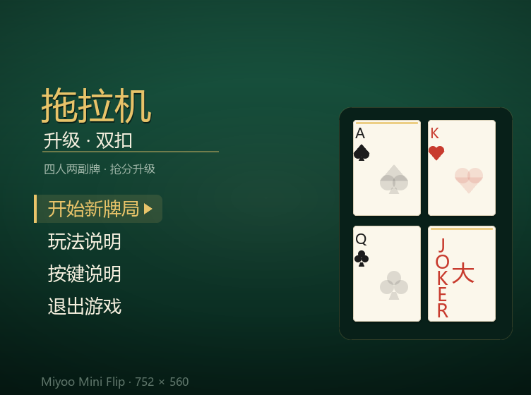
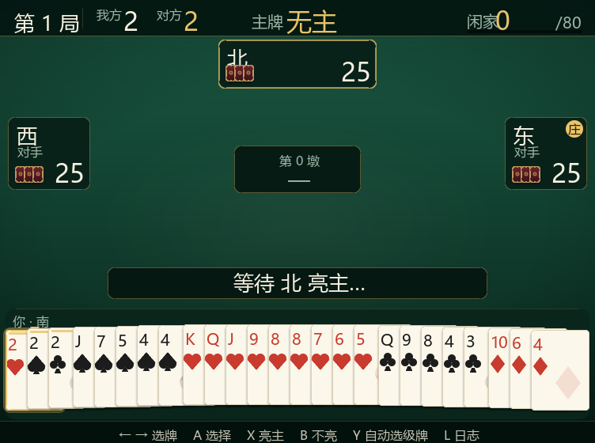
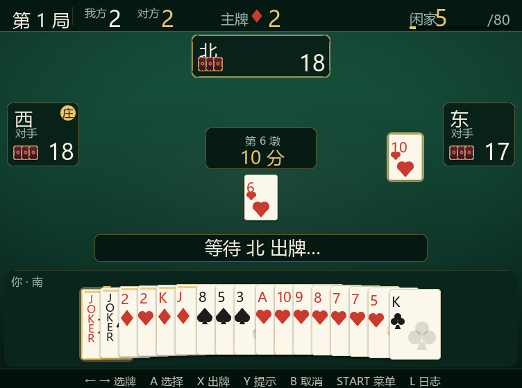
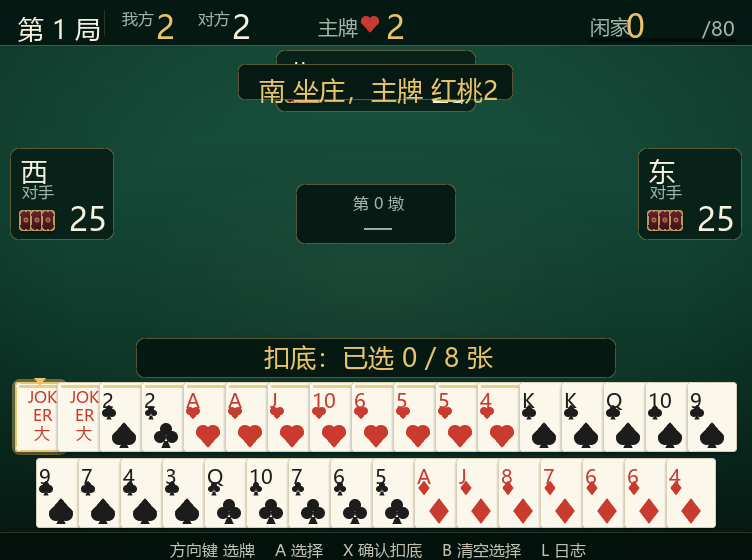
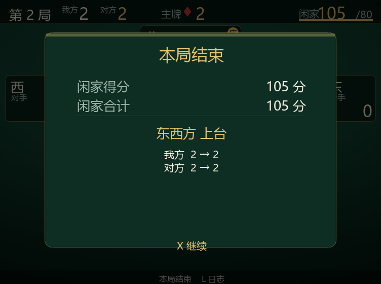
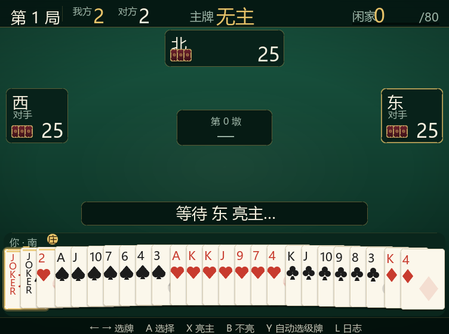
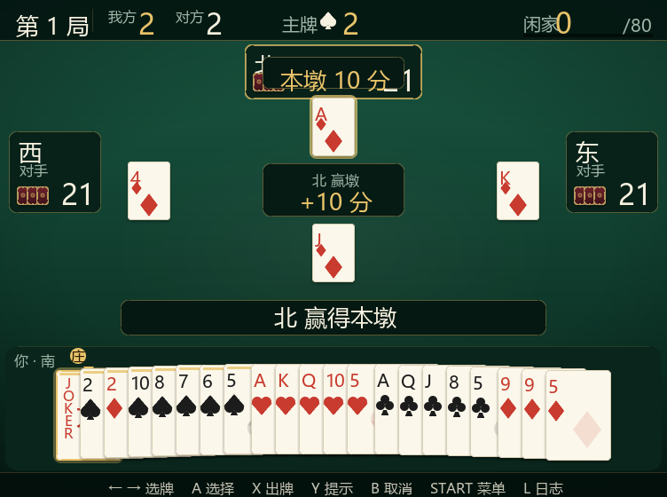
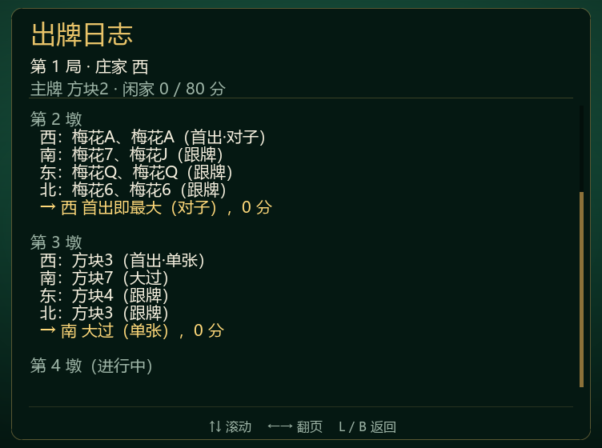
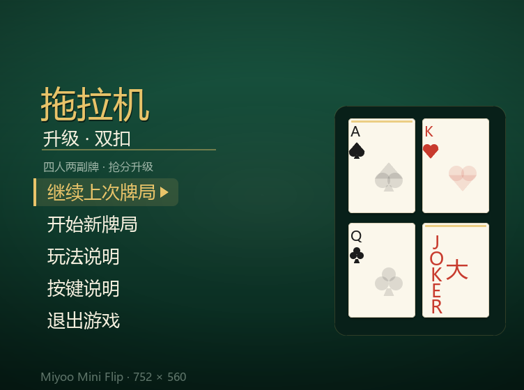
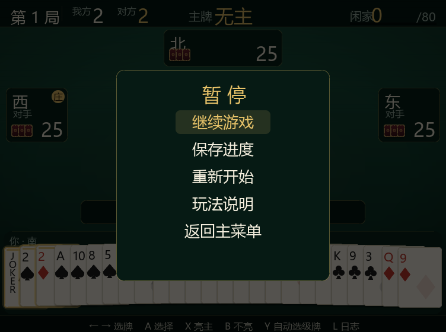

# 拖拉机 · 升级 —— Miyoo Mini Flip 移植版

把 [smallnest/Tractor](https://github.com/smallnest/Tractor)（C# WinForms 的四人拖拉机）的主要玩法移植到
Miyoo Mini Flip 掌机：两副牌发牌、亮主、扣底、跟牌/对子/拖拉机/甩牌、闲家抢分与升级，
界面按 Flip 的 **752×560** 屏幕重新设计。

实现是纯 Go、零外部依赖：自带软件渲染器、点阵中文字体、直接写 `/dev/fb0`、直接读
`/dev/input/event*`，不需要 OnionOS、SDL 或任何运行时库。

## 截图

| 标题 | 亮主 |
| --- | --- |
|  |  |

| 出牌 | 扣底 |
| --- | --- |
|  |  |

| 结算 | 说明 |
| --- | --- |
|  |  |

实机画面（Miyoo Mini Flip，752×560，抓取 framebuffer 后转正）：



按 L1 / L2 查看出牌日志，记录每一墩的出牌、牌型、赢家和得分，
并标注每次跟牌的比较结果：跟牌、压过、毙、对毙、拖拉机毙、盖毙、大过、垫牌。




## 安装到掌机

1. 解压 `dist/Tractor-MiyooMiniFlip.zip`，得到 `Tractor/` 文件夹。
2. 把整个文件夹复制到 SD 卡：`/mnt/SDCARD/App/Tractor/`。
3. 开机进入 **App** 菜单，运行「拖拉机」。

目录里应包含：

```
Tractor/
  launch.sh          # 启动脚本（自动选 arm / arm64）
  icon.png           # 74×74 菜单图标
  tractor-arm        # 32 位 ARM（armv7）
  tractor-arm64      # 64 位 ARM（aarch64）
  README.txt         # 掌机上的说明
```

## 操作

| 按键 | 作用 |
| --- | --- |
| 十字键 | 选牌 / 移动光标 |
| A | 选中 / 取消一张牌 |
| X | 出牌、确认、亮主、扣底 |
| Y | 提示（自动选出一手合法牌） |
| B | 取消选择 / 不亮 |
| START | 暂停菜单（可保存进度） |
| SELECT | 玩法说明 |
| L1 / L2 | 出牌日志（↑↓ 滚动、←→ 翻页，再按 L 或 B 返回） |

## 保存进度

发牌、亮主、扣底以及每墩结束后都会自动保存；在暂停菜单里选“保存进度”可以手动保存。
下次启动时标题界面会出现“继续上次牌局”。存档位置为 `/mnt/SDCARD/Saves/Tractor/save.json`，
删除该文件即可放弃进度。



游戏内暂停菜单：



## 已实现的规则

- 4 人 2 队，2 副牌 108 张，每人 25 张，底牌 8 张，共 25 墩。
- 亮主：单张级牌亮主，一对级牌反主；无人亮主打无主；庄家拿底牌并扣 8 张。
- 主牌大小：大王 > 小王 > 主级牌 > 副级牌 > 主花色 A K Q J 10 … 2。
- 牌型：单张、对子、拖拉机（同花色相邻两对，级牌截断顺子）、甩牌（每张都必须是最大，
  否则甩牌失败）。
- 跟牌：先跟同花色；有对必须出对，有拖拉机必须出拖拉机；没有该花色才能垫牌/毙牌。
- 记分：5 = 5 分，10 / K = 10 分，共 200 分；闲家 ≥80 分上台。
- 升级：闲家 0 分大光升 3 级，<40 分小光升 2 级，<80 分升 1 级；闲家每多 40 分多升 1 级。
- 底牌：闲家赢下最后一墩时翻倍，单张 ×2、对子 ×4、拖拉机 ×8；甩牌按其结构，
  含拖拉机 ×8、含对子 ×4，否则 ×2。
- 打到 A 并守庄成功即通关。

## 故障排查

- **画面上下颠倒**：在 `/mnt/SDCARD/Saves/Tractor/` 新建空文件 `rotate0`，重启游戏。
- **想检查屏幕/按键**：在同一目录新建空文件 `diag`，重启进入彩条 + 按键诊断，
  按 SELECT 退出；检查完删掉 `diag`。
- **按键没反应**：看 `Saves/Tractor/keys.log`（记录了收到的原始键码）。
- **黑屏/闪退**：看 `Saves/Tractor/launcher.log`（屏幕参数、启动参数、错误）。
- 程序要求屏幕为 752×560，否则会在日志里报错退出。

## 构建

需要 Go 1.24+：

```sh
# 32 位 ARM（Miyoo Mini 系列常见）
CGO_ENABLED=0 GOOS=linux GOARCH=arm GOARM=7 go build -trimpath -ldflags "-s -w" -o dist/Tractor/tractor-arm ./cmd/tractor

# 64 位 ARM
CGO_ENABLED=0 GOOS=linux GOARCH=arm64 go build -trimpath -ldflags "-s -w" -o dist/Tractor/tractor-arm64 ./cmd/tractor
```

字体图集由 `tools/genfont.py` 用 Windows 的微软雅黑生成（已提交，正常构建不需要重跑）：

```sh
python tools/genfont.py
```

## 代码结构

```
internal/game/    规则引擎：牌、牌型、回合、AI、升级
internal/gfx/     软件渲染器 + 点阵字体（内嵌 PNG 图集）
internal/ui/      界面状态机、牌桌、手牌、标题/说明/结算
internal/platform/ fbdev 呈现（32bpp、FBO pan、180° 旋转）与 evdev 按键
cmd/tractor/      入口、截图模式、设备诊断
```

## 测试

```sh
go test ./...
go run ./cmd/sim -n 120        # 规则引擎压力测试
go run ./cmd/tractor -shot out # 生成 752×560 截图
```

测试覆盖：发牌/牌型/大小/甩牌判定/跟牌规则/整局模拟（多随机种子、总分 200、手牌清空），
以及界面状态机自动跑完整局、真人亮主、真人扣底、手牌布局边界、演示模式与内存占用。

实机：Miyoo Mini Flip（armv7l，752×560，32bpp，双缓冲）上抓取 framebuffer 核对方向、
配色与布局，并用 AI 演示模式跑通发牌、亮主、扣底、出牌，RSS 约 13 MB。按键映射按系统
`button_config`（L2,L,R2,R,X,A,B,Y）逐项核对。

## 许可证

本项目采用 [Apache License 2.0](LICENSE) 发布，版权归 JsBeta 所有。

